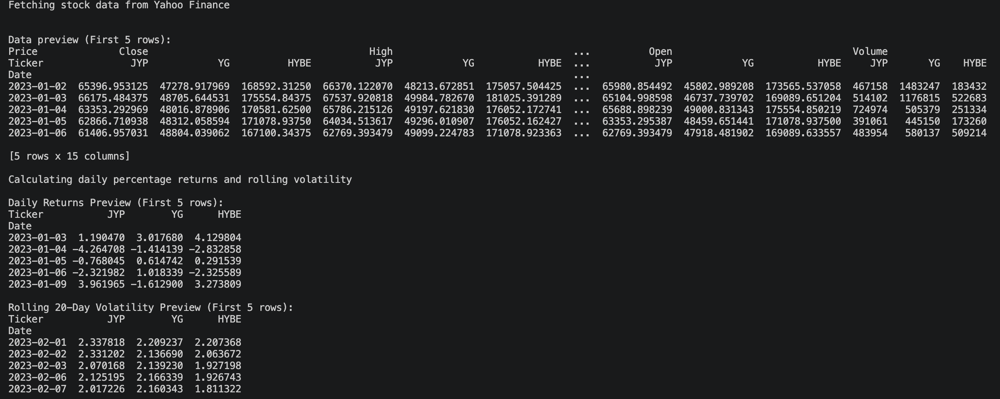
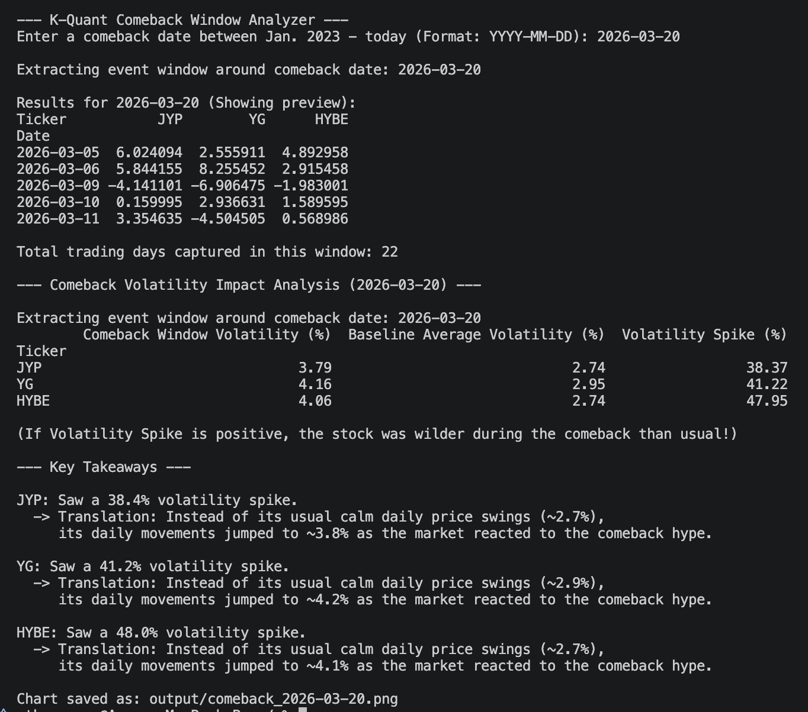
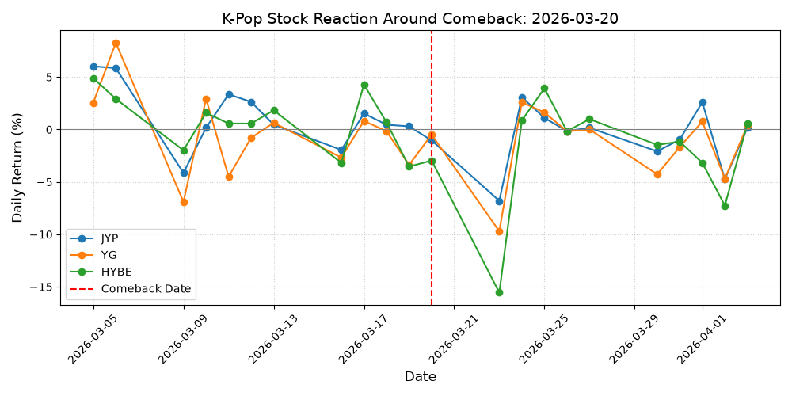
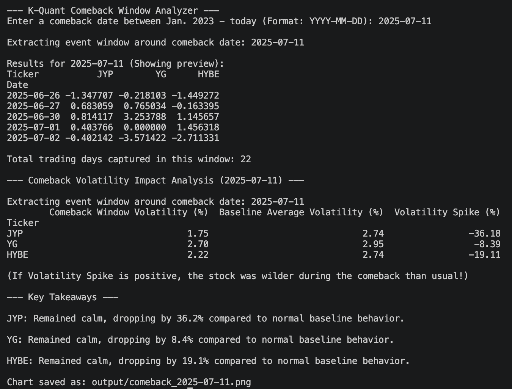
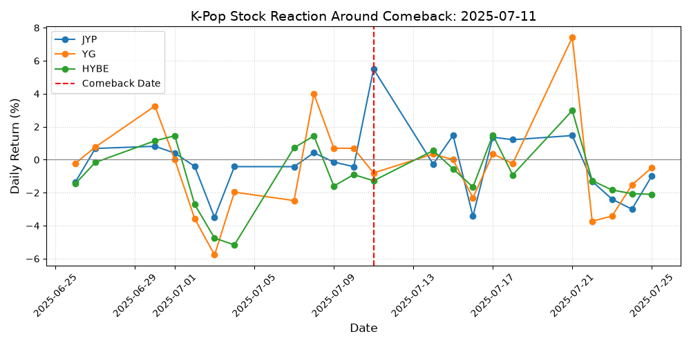
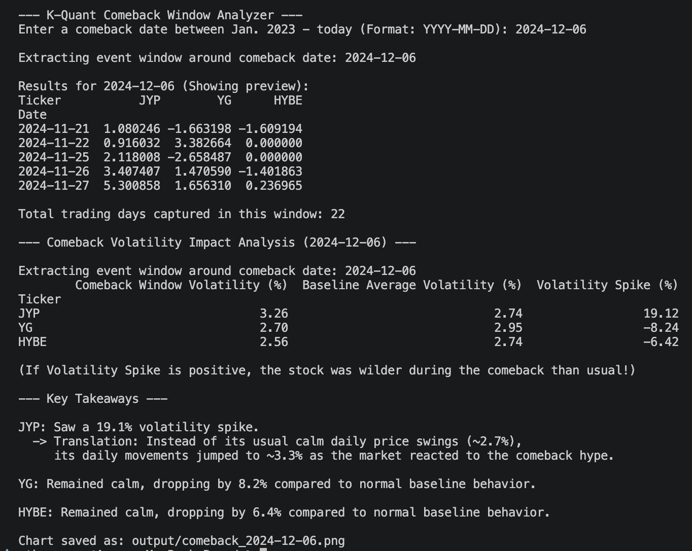
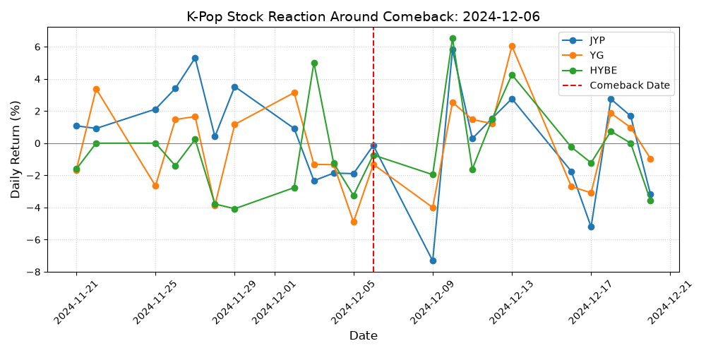
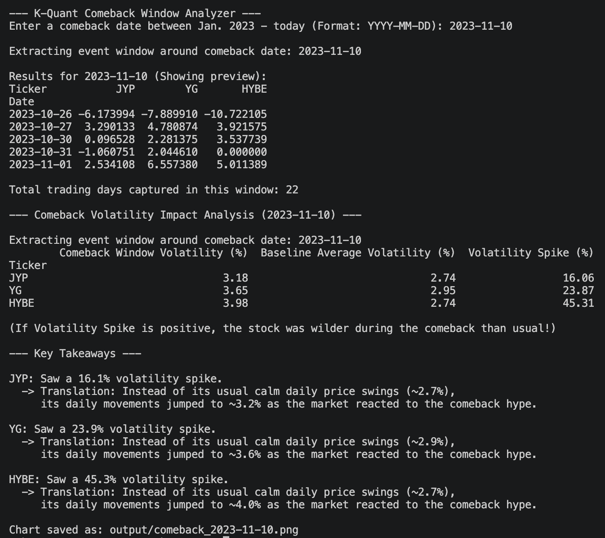
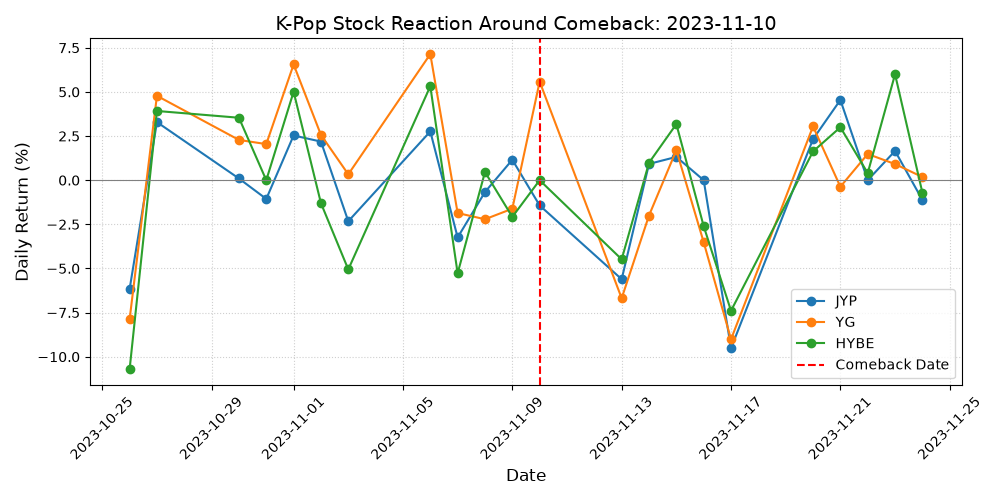

# K-Quant
Fetches historical market data for major South Korean entertainment stocks and analyzes price movements around pop-culture catalysts like group comebacks.

## The Problem

I want to know whether major K-pop entertainment stocks follow predictable patterns around pop-culture events like group comebacks. Basically, I want to see how "hype" around an event drives stock price movements.

## How It Works

Fetches historical daily stock prices including open, high, low, close, and volume for major entertainment agencies like HYBE, JYP, and YG. It then computes daily percentage returns to compare all agencies on an equal percentage scale alongside a rolling 20-day standard deviation to measure stock volatility and identify unusual price drops. Next, it runs a custom function to extract stock performance in a 30-day window ($\pm15$ days) around landmark group comebacks, followed by an automated volatility impact analysis comparing event windows against multi-year baselines. Finally, it uses Matplotlib to generate clear line charts displaying price movements and abnormal returns around these dates compared to baseline market trends.


## Tech Stack

- **Language:** Python
- **Libraries, Packages, and Tools:** `yfinance`, `pandas`, `matplotlib.pyplot`, `os`, `warnings`
- **Data Storage:** Local CSV/DataFrame structures
- **External Sources and Access Method:** Yahoo Finance; API access via the Python `yfinance` package, querying the specific ticker symbols (HYBE: `352820.KS`, JYP Entertainment: `035900.KQ`, YG Entertainment: `122870.KQ`)

## Setup & Running Instructions

Follow these steps to clone and run the project locally:

1. **Clone the repository:**
   ```bash
   git clone https://github.com/Aarya221/k-quant.git
   cd k-quant
   ```

2. **Install the required dependencies:**
   ```bash
   pip install -r requirements.txt
   ```

3. **Run the script:**
   ```bash
   python3 main.py
   ```
   (If `python3` throws an error, try `python main.py`.)

## Example Runs & Input/Output

### Example Startup & Data Preview


Here are four test cases showing the project running with different K-pop release dates as inputs, along with the expected outputs.

### Test Case 1: BTS — *Arirang* (HYBE)
* **Input:** `2026-03-20`
* **Expected Output:**

  
  

---

### Test Case 2: TWICE — *THIS IS FOR* (JYP)
* **Input:** `2025-07-11`
* **Expected Output:**

  
  

---

### Test Case 3: ROSÉ — *rosie* (YG)
* **Input:** `2024-12-06`
* **Expected Output:**

  
  

---

### Test Case 4: Stray Kids — *ROCK-STAR* (JYP)
* **Input:** `2023-11-10`
* **Expected Output:**

  
  

## Roadmap

- [x] Fetch and format historical daily stock prices (Open, High, Low, Close, Volume) for HYBE, JYP, and YG Entertainment using `yfinance` and `pandas`.
- [x] Compute daily percentage returns (to compare all agencies on an equal scale) and rolling 20-day standard deviation (volatility).
- [x] Implement the interactive `get_event_window()` function to extract stock performance in a 30-day window ($\pm15$ days) around target comeback dates.
- [x] Create automated Matplotlib visualization charts displaying price reactions and save them directly into an absolute-path `output/` folder.
- [x] **[Schedule Quadrant Feature]** Build `analyze_comeback_volatility()` to measure percentage spikes in stock volatility during event windows versus long-term multi-year baselines.

## Demo

- **Video Walkthrough:** [Link to video demo]

## Author

Aarya ([GitHub](https://github.com/Aarya221))
