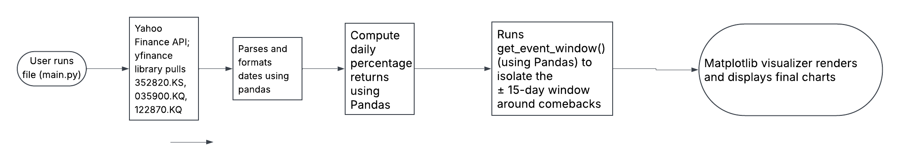

# K-Quant
Fetches historical market data for major South Korean entertainment stocks and analyzes price movements around pop-culture catalysts like group comebacks.

## The Problem

I want to know whether major K-pop entertainment stocks follow predictable patterns around pop-culture events like group comebacks. Basically, I want to see how "hype" around an event drives stock price movements.

## How It Works

Fetches historical daily stock prices including open, high, low, close, and volume for major entertainment agencies like HYBE, JYP, and YG. It then computes daily percentage returns to compare all agencies on an equal percentage scale alongside a rolling 20-day standard deviation to measure stock volatility and identify unusual price drops. Next, it runs a custom function to extract stock performance in a 30-day window ($\pm15$ days) around landmark group comebacks. Finally, it uses Matplotlib to generate clear line charts displaying price movements and abnormal returns around these dates compared to baseline market trends.

## Tech Stack

- **Language:** Python
- **Libraries, Packages, and Tools:** `yfinance`, `pandas`, `matplotlib.pyplot`
- **Data Storage:** CSV files
- **External Sources and Access Method:** Yahoo Finance; API access via the Python `yfinance` package, querying the specific ticker symbols (HYBE: `352820.KS`, JYP Entertainment: `035900.KQ`, YG Entertainment: `122870.KQ`)

## Roadmap

- [ ] Check if entertainment agencies usually move up and down together as a group. Then, see what happens when one big group (like BTS) has a huge comeback or a major controversy; does it make that company's stock break away from the others, and does it eventually snap back to match the industry trend?
- [ ] Measure how wild a company's stock behavior gets during a specific group's milestones (like a BTS, BLACKPINK, or TWICE release) compared to regular boring business financial reports. This would show whether an agency's stock is dependent on just one single music group.
- [ ] Track how fast a new music video gets views in its first week on YouTube. Then, check if that internet hype actually connects to the stock price jumping up over the next 48 hours.

## Author

Aarya (https://github.com/Aarya221))
